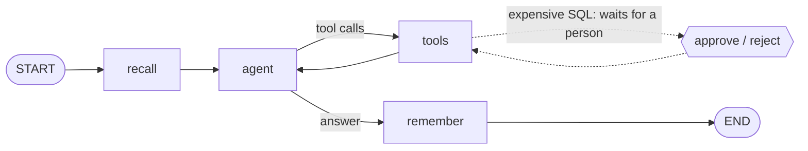

# secop-analyst

An agent that answers questions about Colombian public contracts, built as a LangGraph state graph and run
as a service: Postgres with pgvector for the data and the long-term memory, Redis for working memory,
OpenTelemetry traces, and manifests that run it on a local Kubernetes cluster.

It reads a slice of [SECOP II](https://www.datos.gov.co/Gastos-Gubernamentales/SECOP-II-Contratos-Electr-nicos/jbjy-vk9h),
the open dataset of the Colombian state's electronic contracts, kept up to date by an incremental sync.



| Node | What it does |
|---|---|
| `recall` | Loads what is known about the user that bears on the question, from both memory tiers. |
| `agent` | The model, with two tools: hybrid search over what each contract is for, and read-only SQL. |
| `tools` | Runs the tool calls. SQL the planner estimates as expensive pauses the run until a person decides. |
| `remember` | Takes the facts worth keeping out of the exchange and hands them to memory. |

## What it shows

- **A graph with a human in the loop that survives a restart.** State is checkpointed in Postgres after every
  node. An expensive query calls `interrupt()` with the SQL and its estimated cost; the run is resumed with
  `Command(resume=...)`, by another process if need be. A test pauses a run and resumes it from a graph object
  built afterwards.
- **SQL written by a model, contained by the database.** A statement runs as a subquery, through the extended
  protocol, in a read-only transaction with a timeout, as a role that can read one table. A write, a second
  statement, another table and a slow query are each refused in the tests. An SQL error goes back to the model
  as a tool result, so it can correct itself.
- **Hybrid search in one SQL statement.** Nearest vectors (pgvector, HNSW) and keyword matches (`tsvector`,
  Spanish) fused by reciprocal rank.
- **Agent memory in two tiers, with promotion and demotion.** A fact seen once waits in Redis with a time to
  live. Seen or recalled three times, it moves to Postgres. Unused for thirty days, it goes back to Redis one
  step from promotion, and expires there unless it is recalled. See [memory.py](memory.py).
- **One trace per request.** A span per graph node, model call (with token counts under the `gen_ai.*`
  conventions), tool call, SQL statement and Redis command, sent over OTLP to a collector.
- **It runs as a service.** Streaming answers over server-sent events, a rate limit per user that holds
  across replicas, liveness and readiness probes that mean different things, two replicas behind a Service,
  schema migrations that are safe when both start at once, and two CronJobs: the nightly sync and the memory
  demotion.
- **An incremental sync.** Each slice of the dataset keeps a cursor. A second run asks upstream only for what
  changed and embeds only the rows whose text changed.

The reasons behind each of these are in [docs/decisions.md](docs/decisions.md).

## Run it

Docker is the only requirement. Without an API key, `FAKE_MODEL=1` replaces the model with a stand-in that
searches for the question (or runs it as SQL when it starts with `sql:`), which is enough to see every part
work.

```
FAKE_MODEL=1 docker compose up -d --build       # or, with a model: ANTHROPIC_API_KEY=... docker compose up -d --build
uv run python ingest.py                         # Cauca, contracts signed since 2025
export ANALYST_KEY=$(docker compose run --rm migrate python keys.py create demo)   # shown once
python chat.py "alimentación escolar"
python chat.py "sql: SELECT entity, sum(value_cop) FROM contracts GROUP BY entity ORDER BY 2 DESC LIMIT 5"
```

The API is on `http://localhost:8000` and the traces on `http://localhost:16686`. Every route but `/healthz`
and `/readyz` needs `Authorization: Bearer <key>`; the user is the key's owner, so a request cannot name
someone else. `GET /memory` shows what the agent remembers about the caller and `DELETE /memory` erases it.

On a local Kubernetes cluster ([kind](https://kind.sigs.k8s.io)):

```
cp k8s/local/secret.env.example k8s/local/secret.env
docker build -t secop-analyst:local .
kind create cluster --config k8s/local/kind.yaml
kind load docker-image secop-analyst:local --name secop-analyst
kubectl apply -k k8s/local
kubectl -n secop-analyst create job --from=cronjob/ingest ingest-now     # the first sync, without waiting for the schedule
export ANALYST_KEY=$(kubectl -n secop-analyst exec deploy/api -- python keys.py create demo)
ANALYST_URL=http://localhost:8080 python chat.py "mantenimiento de vías"
```

Jaeger is then on `http://localhost:16687`.

The tests need Postgres and Redis and nothing else: no model and no embedding model.

```
docker compose up -d postgres redis
uv run pytest       # 32 tests
```

## Measured

All on 5 October 2026, on a laptop. This table used the fake model; the one real question is below it.

| | |
|---|---|
| Default slice loaded | 35,718 contracts of 91 entities in Cauca, signed from 1 January 2025 to 4 October 2026 |
| First sync, download and embedding on CPU | 974 s, while other builds were running on the same machine |
| Table with its indexes | 148 MB |
| Hybrid search, query embedding included | median 15 ms, slowest 63 ms, over 30 queries |
| Planner cost of a full scan, an aggregate, a self-join | 5,229, 5,409 and 32,261; the approval threshold is 20,000 |
| On kind, two replicas | sync of 1,696 contracts in 99 s; a fact stated to one replica and repeated to the other was promoted to long-term memory; the traces reached Jaeger |

### One real question

The service has answered one question with a model (Claude Sonnet 5.5 for the agent, Claude Haiku 4.5 for
memory): "¿Qué entidades del Cauca contrataron más en 2025 y en qué?". The whole exchange is in
[chat-output.txt](chat-output.txt). The numbers come from the request's trace.

| | |
|---|---|
| What the agent did | 3 model calls and 4 SQL queries (a ranking, a breakdown by type and modality, the three largest contracts of six entities, a breakdown by type per entity). It did not use search. |
| Figures in the answer checked against the database | 38, all correct: the eight entities' counts and totals, the two medians, the contract values and the breakdowns |
| Time to the last byte | 33 s, of which 30 s were the three model calls |
| Tokens of the three agent calls | 14,585 in, 3,021 out: about $0.06 at list price ($2 and $10 per million) |
| Approval | not asked for: no query was estimated above the threshold |

What that run showed that needed fixing, fixed since and **not yet run again with a model**:

- The trace had 448 spans, most of them one per streamed chunk. Those are now left out.
- The memory call was not in a span, so its tokens are missing from the cost above.

And one thing it showed that is not fixed: the fact the small model chose to remember was "the user asks about
public contracting in Cauca, specifically entities and their lines of investment in 2025". That is the topic
of one question, not a lasting fact about the user, which is what the prompt asks for.

## Limits

- **One question is not an evaluation.** It says the path works and that this answer was right. It says nothing
  about how often the model writes wrong SQL, misreads a column or answers beyond the loaded slice.
- **Search quality is not evaluated.** For "mantenimiento de vías rurales" the first result was the repair of a
  school building. The dataset has its own ground truth for a first evaluation: questions whose answer is a
  SQL query.
- **The memory thresholds are reasoned, not measured:** three sightings to promote, seven days to live,
  thirty to demote, 0.85 and 0.35 as similarity cut-offs. Being recalled counts as use, and recall is by
  similarity, so a fact that is merely near many questions gets promoted without having helped.
- **API keys, not accounts.** A key is created and revoked from the command line (`keys.py`) and stored as a
  hash; there is no sign-up, no expiry and no scopes. Deleting the memory does not delete the conversation
  threads.
- **The whole thread goes to the model on every turn.** Long conversations are not summarised.
- **Memory extraction happens inside the request,** after the answer has streamed. The connection stays open
  until it finishes.
- **Promotion and demotion write to two stores without a shared transaction.** A crash between the writes
  duplicates a fact; it does not lose one.
- **The Kubernetes setup is for a local cluster.** Postgres is a single pod with a volume, Redis has no
  persistence, Jaeger keeps traces in memory, and there is no ingress, autoscaling or network policy. The
  infrastructure for a cloud is in [terraform-cloud-platform](https://github.com/0103juan/terraform-cloud-platform),
  and has not been applied.
- **Traces only.** No metrics and no log correlation.
- Runs on Linux containers. On Windows the tests run natively; the service does not, because of the event loop
  psycopg's async mode needs.
- The supplier's document number is not loaded: for a natural person it is a national ID.

## Licence

MIT. See [LICENSE](LICENSE).
